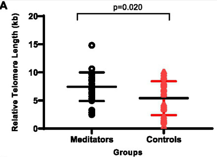
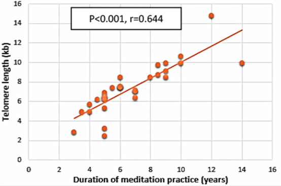

## Background Information

:term{id="telomeres"} are stretches of repeated DNA that cap the ends of chromosomes. In the body's ordinary cells they are typically 5,000 to 15,000 DNA letters long (5–15 kilobases, kb), and they lose some length each time a cell divides. As the paper's introduction explains, losing these caps can push cells into senescence or death and make the genome unstable.

Telomeres can be lengthened again by the enzyme :term{id="telomerase" case="lower"}. Its activity depends on two genes: hTERT, which encodes the enzyme's core protein, and hTR, which encodes its RNA component. How actively a gene is read is controlled partly by its promoter, the stretch of DNA in front of it, and chemical tags called :term[DNA methylation]{id="dna_methylation"} on the promoter of hTERT are linked to switching the gene off.

The authors note that most earlier studies of meditation and telomeres were in patients, such as people with cancer, depression or Alzheimer's disease, and only a few were in healthy people. Results have been mixed. Some studies found longer telomeres, higher telomerase activity or more active telomerase genes in meditators, including a study of [intensive meditation training by Jacobs and colleagues](/immune-telemorase-psychological-mediators/), while others found no change. Most of the reported changes came after short programs of 4 to 12 weeks.

This paper reports on the same group of people as an earlier one by the same team, which found that the long-term meditators had higher telomerase levels in their blood plasma, higher trait :term{id="mindfulness" case="lower"} and better quality of life. Here the team looked further along the chain: at telomere length itself, at the two telomerase genes, and at methylation of the hTERT promoter.

## What They Did

The team recruited 30 healthy long-term meditators who practiced at meditation centres around Sri Lanka, and 30 people from the same communities who had never or rarely meditated. Each non-meditator was matched to a meditator for sex, educational level and age (within two years). To count as a long-term meditator, a person had to have meditated for more than 6 hours a week for at least three years, and to reach set skill levels on a questionnaire-based screening tool the team had developed. People with any illness or regular medication, smokers, and pregnant or breastfeeding women were excluded.

In each group, 19 of the 30 were men, and the average age was about 43. Everyone was of Sinhalese ethnicity, and all but three were :term[Theravada Buddhists]{id="theravada"}. The meditators had practiced for 6.8 years on average and reported meditating 5.82 hours a day. They practiced one or more of :term{id="loving_kindness" case="lower"}, breathing and :term[body scan]{id="body_scan"} meditation. The groups didn't differ significantly on body mass index, sleep, alcohol use, diet or exercise. Recruitment ran from August 2020 to December 2021.

Everyone gave one blood sample between 8:30 and 9:00 in the morning. From it the team measured three things:

- **Telomere length**, in DNA from white blood cells, using quantitative PCR (qPCR). This doesn't measure single telomeres directly. It compares how much telomere sequence a sample contains with a gene present in a single copy, relative to a reference sample of known length, and converts the result to an estimated average length in kilobases. The paper calls this the relative telomere length.
- **Activity of hTERT and hTR**, from RNA in whole blood, measured as :term{id="gene_expression" case="lower"} relative to a standard reference gene.
- **Methylation of the hTERT promoter** at 39 sites, read by DNA sequencing.

Participants had also filled in the :term[Five Facet Mindfulness Questionnaire]{id="ffmq"} and the World Health Organization's quality-of-life questionnaire, results the team had reported before. The groups were compared with t-tests, and the links between telomere length and other measures with :term[correlations]{id="correlation"} and a regression model.

## One Big Result: Meditators' Telomeres Were About 32% Longer on Average

The long-term meditators had longer telomeres: 7.35 kb on average (standard deviation 2.53) against 5.57 kb (standard deviation 3.15) for the non-meditators (p = 0.020). That is a difference of 1.78 kb, or about 32%. The paper puts the :term{id="effect_size" case="lower"} at Cohen's d = 0.61. The spread within each group was larger than the 1.78 kb gap between them.

The two telomerase genes were also more active in the meditators:

- **hTERT:** 8.67 on average (standard deviation 13.28) against 2.82 (4.11), p = 0.020
- **hTR:** 10.53 (22.75) against 1.96 (2.13), p = 0.029

The paper reports these as fold changes of 1.3 and 1.4. The values varied widely, especially among the meditators, whose standard deviations were larger than their averages.

Averaged across the hTERT promoter sites, methylation was 62.64% in the meditators against 76.75% in the non-meditators (p < 0.001). Looking site by site, methylation was significantly lower in the meditators at 12 of the 39 sites after adjusting for age, sex and diet. The less methylated the promoter, the more active the hTERT gene (r = −0.589).

One sentence of the results contradicts these numbers. It says the promoter "had overall higher methylation levels in the meditators than in non-meditators", while the abstract, the discussion and the averages it reports all point to lower. The same sentence gives an :term{id="odds_ratio" case="lower"} of 12.640 with a 95% confidence interval of 0.366 to 4.614, a range that doesn't include the odds ratio itself. The paper doesn't explain either discrepancy.

## Miscellaneous Interesting Takeaways

### Years of Practice Went With Longer Telomeres

Among the meditators, those who had practiced for more years had longer telomeres (r = 0.644, p < 0.001), which the authors call a strong correlation. More years of practice also went with less methylation of the hTERT promoter (r = −0.580).

Older participants had shorter telomeres (r = −0.675), and age was the only background factor linked to it. In a regression model that included age, years of practice and the psychological measures, only age and years of practice remained as predictors of telomere length. Like the group difference, these are correlations measured at one time, so they can't show that practice lengthened anyone's telomeres.

### Mindfulness and Quality of Life

Longer telomeres went with higher scores on two mindfulness facets, acting with awareness (r = 0.410) and non-reactivity (r = 0.309), and on two quality-of-life areas, physical health (r = 0.438) and social relationships (r = 0.282). The questionnaires are self-reports, and non-reactivity and social relationships didn't contribute to the final regression model.

### The Study Couldn't Compare Techniques

The meditators practiced different techniques, and many practiced two or more, so the team couldn't analyze the results by technique. The authors offer a cautious suggestion:

> Interestingly, our results showed positive effects of meditation in long-term meditators who had been practicing different types of meditation techniques, which may suggest that the beneficial effects of meditation may not primarily be dependent on the specific technique, and should ideally be confirmed with a larger multi-arm study comprising practitioners of different techniques.

### Skilled, Not Just Experienced

Rather than taking years of practice alone as the entry criterion, the team screened meditators with their own skill questionnaire. The authors think this helped them find significant differences "even with a limited sample size". The sample size was chosen to give 80% power for an effect size of 0.8 in hTERT activity.

## Final Reflection

This study measured several steps of the same chain in one group of people: the methylation that helps switch hTERT off, the activity of the two telomerase genes, and the length of the telomeres themselves. At each step the long-term meditators differed from matched non-meditators, with less methylation, more active genes and longer telomeres, and more years of practice went with longer telomeres and less methylation.

The design limits what that can mean. It was a one-time comparison of 30 people per group, nearly all Sinhalese Buddhists and mostly men. People who spend nearly six hours a day meditating for years may differ from others in many ways besides meditation, and the authors call confounding the study's major challenge:

> Furthermore, this study is cross-sectional in nature, which should be considered as a limitation, as it restricts the ability to establish causal relationships of the findings.

The paper ran many tests, including one for each of 39 promoter sites, and doesn't report correcting for :term{id="multiple_comparisons" case="lower"}. Its methylation results also contain the contradiction noted above.

The authors' conclusion is more confident than the design allows, speaking of "beneficial effects" rather than associations:

> The findings suggest that meditation as a lifestyle practice has multi-level beneficial effects on telomere dynamics with potential to promote healthy aging.

They recommend confirming the findings in a larger study that follows people over time. For a randomized test of meditation and telomeres, see the [Age-Well trial in older adults](/meditation-older-adults-telomeres/).
